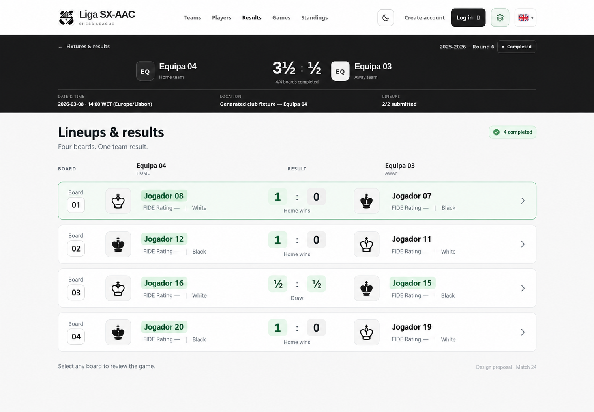

# Match 24 redesign proposal

This proposal changes the lineup and board-result section below the existing website header and match banner. The header, team scoreboard, season/round, venue, date and lineup metadata retain their current design.

- Four separate board cards use consistent columns for board number, home player, score and away player.
- Piece icons and White/Black labels distinguish playing colour from home/away assignment.
- Winning names and scores retain a strong green highlight; drawn names and scores use a lighter tint.
- Player names lead, with FIDE Rating shown as secondary information. Missing ratings remain unspecified.
- Whole-row navigation opens the corresponding game review, with a quiet chevron instead of a separate button.
- On mobile, the two players can stack with their scores aligned right, keeping the same information and highlights.

The mockup uses the public results of match 24: Equipa 04 vs Equipa 03, 3½–½. It is a design proposal; the application has not been changed.

