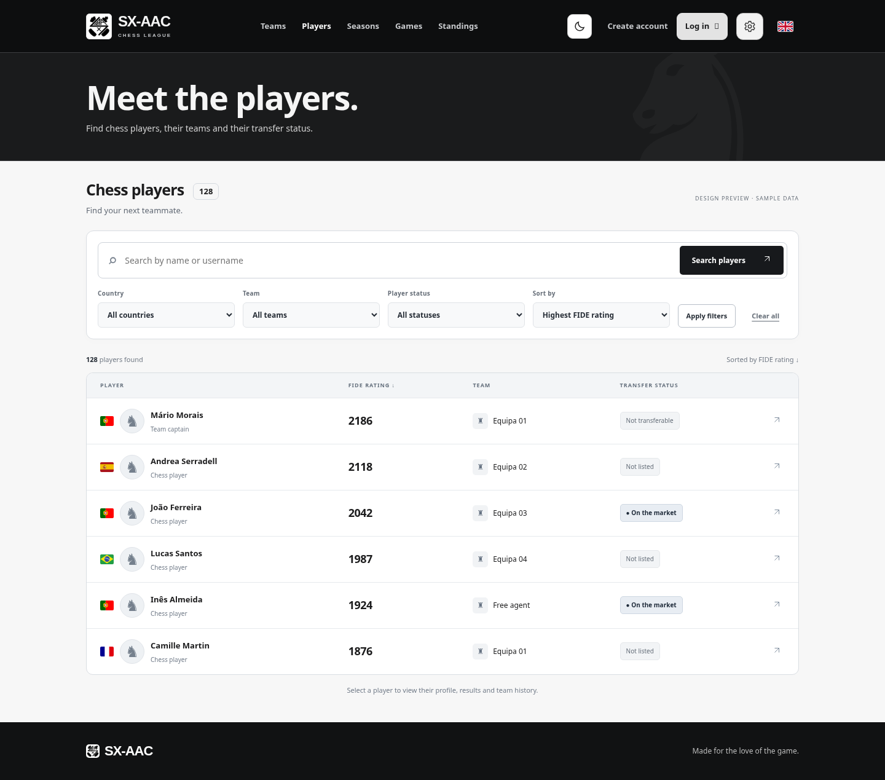
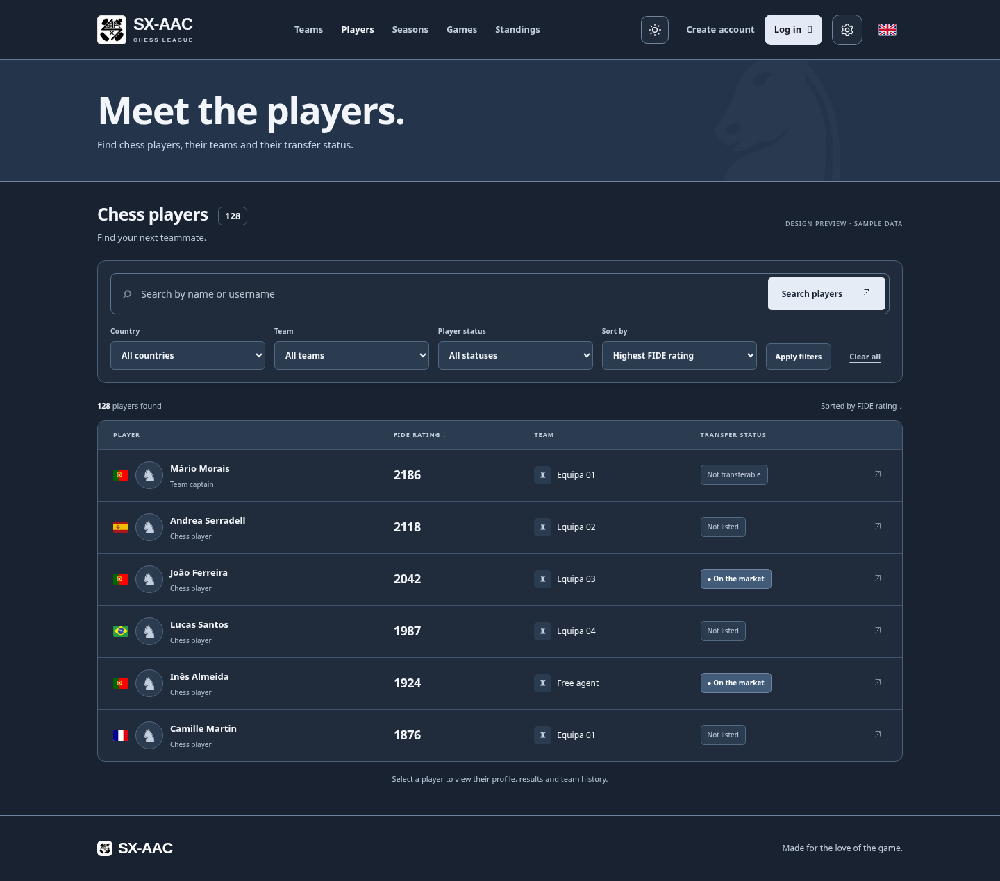
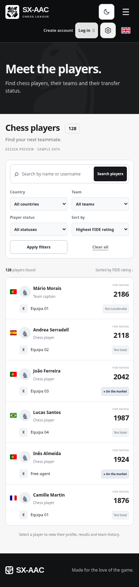

# Players page redesign concept

Visual proposal using illustrative player names, ratings, teams and counts. This preview does not change the live application or its database.

- Preserve the existing site header and page banner.
- Put name/username search in a full-width field with a clear action.
- Group the existing country, team, status and sorting filters in one compact panel, retaining Apply filters and Clear all.
- Align flags, avatars and player names in a single identity column.
- Emphasise FIDE ratings and keep team and transfer status easy to scan.
- Retain player-profile row navigation and independent team-profile links when implemented.
- Use compact stacked rows on mobile, with the rating beside the player identity.
- Use neutral light surfaces and the existing blue dark-mode palette.
- Preserve keyboard navigation, accessible labels, translations and dynamic country options during implementation.

The images are static visual mockups; their controls are not interactive. The shown 128-player count is illustrative, with six example rows displayed.

## Desktop

## Dark mode

## Mobile

